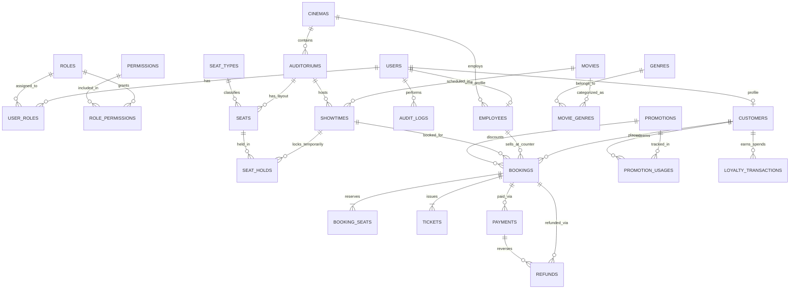

# Sơ Đồ Thực Thể Liên Kết (ERD) - Cinema Management System (CMS)

## 1. Sơ đồ ERD (Mermaid Diagram)

## 2. Ràng buộc toàn vẹn & Chống bán trùng ghế (Concurrency & Data Integrity)

1. **Ràng buộc duy nhất cấp độ Database (`@@unique([showtimeId, seatId])`)**:
   - Bảng `seat_holds`, `booking_seats` và `tickets` đều áp dụng khóa duy nhất trên cặp `(showtime_id, seat_id)`.
   - Khi hai giao dịch đồng thời cố gắng giữ hoặc mua cùng một ghế `E8` trong suất chiếu `ST-01`, PostgreSQL `SERIALIZABLE` / `READ COMMITTED` kết hợp khóa dòng (`SELECT ... FOR UPDATE`) và `UNIQUE CONSTRAINT` sẽ từ chối giao dịch thứ hai ngay lập tức với mã lỗi `409 Conflict`.
2. **Kiểu dữ liệu tiền tệ (`Decimal(14, 0)`)**:
   - Mọi trường tiền tệ (`base_price`, `surcharge_rate`, `subtotal_amount`, `discount_amount`, `final_amount`, `amount`) đều lưu dưới dạng số nguyên chính xác `Decimal(14, 0)` theo đơn vị VNĐ, tuyệt đối không dùng `FLOAT`/`DOUBLE`.
3. **Bảo toàn lịch sử phòng chiếu**:
   - Trước khi cập nhật sơ đồ ghế (`auditoriums`), hệ thống kiểm tra xem phòng chiếu có suất chiếu đang mở bán hoặc vé đã phát sinh hay không. Nếu có, hệ thống từ chối thay đổi cấu trúc hàng/cột và yêu cầu đóng các suất chiếu liên quan trước.
